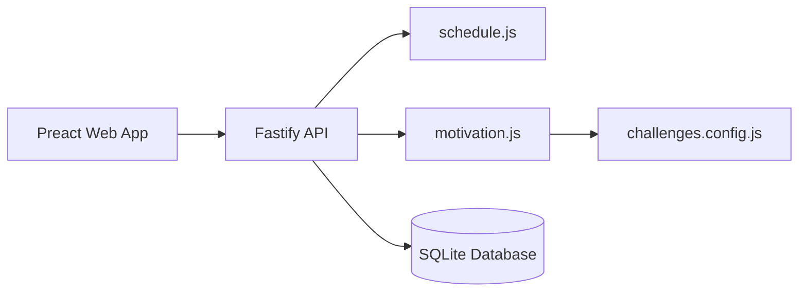

# Requirements

### Overview & Goals
Deliver the second iteration of **Chorelenger**, introducing the core motivation system specified in `.planning/PROJECT.md`:
1. **Monthly Themed Challenges**: Spotlight relevant chores each month to encourage focused habits.
2. **Unlimited-Count Extra Buttons**: Temporary, theme-specific action buttons (e.g., "Pet dog", "Drink water") that increment a monthly challenge counter with single-tap frictionless logging and undo.
3. **Monthly Reward Measurement**: Objective measurement of monthly performance—Base Reward when scheduled execution is ≥ 95%, and Extra Reward when extra challenge taps meet the monthly goal threshold.
4. **Informational Achievements**: Pure dopamine-hit badges awarded for notable milestones and consistency patterns.
5. **Operational Polish**: Fix the client local date issue in History and add `--experimental-sqlite` to the `start` script for seamless Node 22.5–22.12 execution on Termux.

### Scope
- **In Scope**:
  - Modular motivation engine (`server/motivation.js` & `server/challenges.config.js`).
  - SQLite table for tracking extra button completions with undo support.
  - API endpoints for active monthly challenge, extra tap/undo, and motivation/achievements summary.
  - UI additions: Themed challenge spotlight banner, quick-tap Extra Buttons, new "Motivation" tab with Reward gauges and Achievement badges.
  - Unit tests for reward math, achievement rules, and API endpoints.
  - Fix for UTC-offset date bug in History and `start` script flag in `package.json`.
  - Comprehensive documentation log entry in `log.md`.
- **Out of Scope**:
  - Web Push notifications (deferred to Iteration 3 to keep Iteration 2 focused on motivation mechanics).
  - In-app reward redemption or financial tracking (app only measures achievement; user rewards themselves in real life).
  - Multi-user accounts or social sharing.

### User Stories
- **US1 (Monthly Challenges & Spotlight)**: *As a user*, I want to see the current month's theme on my dashboard and see related chores highlighted so that I feel inspired to focus on thematic habits.
- **US2 (Extra Action Buttons)**: *As a user*, I want quick-tap buttons for small thematic positive actions that increment my monthly counter instantly and disappear after the month ends so that I can log extra efforts without cluttering regular chores.
- **US3 (Monthly Reward Measurement)**: *As a user*, I want to clearly see whether I qualified for my base reward (≥95% execution) and extra reward (reaching extra goal) so that I have objective feedback to reward myself.
- **US4 (Informational Achievements)**: *As a user*, I want to unlock achievement badges when reaching consistency milestones so that I get rewarding visual feedback for my long-term discipline.

### Functional Requirements
- **FR1 (Challenge Presets)**: System provides preset monthly challenges defined in `server/challenges.config.js` with month identifier, title, description, spotlight categories/chore keywords, target extra count, and custom extra buttons.
- **FR2 (Extra Button Tracking)**: Single tap logs an extra completion in `extra_completions`. UI provides a 6-second undo toast. Extra buttons only appear during their active calendar month.
- **FR3 (Chore Spotlight)**: Chores on the Today screen matching the active challenge category or keyword receive a thematic badge/accent.
- **FR4 (Base Reward Calculation)**: For a given month, compute scheduled chore opportunities and completion rate. If completed / expected ≥ 0.95, base reward is marked achieved.
- **FR5 (Extra Reward Calculation)**: If total extra taps for the active month ≥ challenge target, extra reward is marked achieved.
- **FR6 (Achievements Evaluation)**: System evaluates milestone rules (e.g. First Chore, Clean Streak, 95% Club, Extra Enthusiast, Century Club) and marks badges as unlocked with date.
- **FR7 (Local Date Handling)**: History tab queries use client local date (`YYYY-MM`) rather than UTC string to prevent midnight boundary errors.

### Non-Functional Requirements
- **Zero Native Dependencies**: Maintain strict compatibility with Termux on Android using built-in `node:sqlite`.
- **Frictionless UX**: Logging extras and viewing progress requires minimal taps and runs smoothly on mobile screens.
- **Test Coverage**: Pure calculation functions in `server/motivation.js` and all API endpoints must be covered by automated Node tests.

# Technical Design

### Current Implementation
- `server/schedule.js`: Handles recurrence math (interval, flexible window, calendar date) and chore status (`overdue`, `due`, `upcoming`).
- `server/db.js`: Initializes SQLite database with `chores`, `completions`, and `sessions`.
- `server/app.js`: Fastify API with password cookie auth, chore CRUD, done/undo endpoints, and monthly history.
- `web/src/main.jsx`: Preact SPA with tabs for Today, Chores, History, and Login.

### Key Decisions
- **Decision 1: Modular Motivation Engine (`server/motivation.js`)**: Keep reward rate calculation, streak detection, and achievement rules in a pure, standalone module with zero side-effects, mirroring the existing `server/schedule.js` architecture.
- **Decision 2: Preset Config (`server/challenges.config.js`)**: Store monthly challenge themes and extra button configurations in a structured preset file, allowing predictable seasonal progression with minimal database migration overhead.
- **Decision 3: Dedicated `extra_completions` Table**: Record extra button taps separately from regular recurring chores, ensuring that ad-hoc extra actions do not skew core recurrence schedules or completion intervals.

### Architecture Diagram


### Data Models / Contracts

#### SQLite Schema Additions (`server/db.js`)
```sql
CREATE TABLE IF NOT EXISTS extra_completions (
  id INTEGER PRIMARY KEY,
  month TEXT NOT NULL,
  extra_id TEXT NOT NULL,
  done_date TEXT NOT NULL,
  done_at TEXT NOT NULL DEFAULT (datetime('now'))
);
CREATE INDEX IF NOT EXISTS idx_extras_month ON extra_completions(month, extra_id);
CREATE INDEX IF NOT EXISTS idx_extras_date ON extra_completions(done_date);
```

#### Challenge Preset Contract (`server/challenges.config.js`)
```javascript
export const MONTHLY_CHALLENGES = {
  // Keyed by month number (1-12) or specific YYYY-MM
  1: {
    id: 'fresh-start',
    title: 'Fresh Start & Declutter',
    description: 'Kick off the year with a clean space and clear mind.',
    spotlightCategories: ['home', 'cleaning'],
    extraGoal: 20,
    extras: [
      { id: 'quick-tidy', label: '10-min Tidy', icon: '✨' },
      { id: 'water-plants', label: 'Hydrate / Plants', icon: '🌱' }
    ]
  },
  // ... 2 through 12 preset templates
};
```

#### API Endpoints
- `GET /api/challenge/current`:
  ```json
  {
    "month": "2026-10",
    "challenge": {
      "id": "pets-nature",
      "title": "Month of the Pets & Outdoors",
      "description": "Focus on animal care and outside time.",
      "spotlightCategories": ["dog", "outdoors", "health"],
      "extraGoal": 30,
      "extras": [{ "id": "pet-dog", "label": "Pet Dog", "icon": "🐾" }]
    },
    "spotlightChoreIds": [1, 4],
    "extraCounts": { "pet-dog": 12 },
    "totalExtras": 12,
    "extraGoalMet": false
  }
  ```
- `POST /api/challenge/extra`:
  - Request body: `{ "extra_id": "pet-dog" }`
  - Response: `{ "completionId": 14, "extra_id": "pet-dog", "totalCount": 13 }`
- `DELETE /api/challenge/extra/:id`:
  - Response: `{ "ok": true }`
- `GET /api/motivation`:
  - Response:
    ```json
    {
      "month": "2026-10",
      "reward": {
        "executionRate": 0.96,
        "baseRewardAchieved": true,
        "extraRewardAchieved": false,
        "extraCurrent": 12,
        "extraGoal": 30
      },
      "achievements": [
        { "id": "first-chore", "name": "First Step", "desc": "Completed your first chore", "unlocked": true, "unlockedAt": "2026-10-06" },
        { "id": "discipline-95", "name": "95% Club", "desc": "Achieved ≥95% monthly execution", "unlocked": true, "unlockedAt": "2026-10-31" }
      ]
    }
    ```

### Components
- `Today`: Displays active challenge header banner with progress bar, quick-tap Extra Buttons list, and spotlighted chore styling.
- `MotivationView` (new): Renders Monthly Reward Status Card (gauge for base rate ≥95%, extra taps counter) and the Achievements Gallery (grid of unlocked and locked badges).
- `ChoreCard`: Updated to support `spotlight: true` badge rendering.
- `NavBar`: Includes tabs `['today', 'chores', 'motivation', 'history']`.

### File Structure
- `server/challenges.config.js` (new) — preset monthly challenge definitions and extra buttons.
- `server/motivation.js` (new) — pure execution math, reward status, and achievement rules.
- `server/motivation.test.js` (new) — unit test suite for motivation algorithms.
- `server/db.js` (modified) — adds `extra_completions` table and indices.
- `server/app.js` (modified) — registers challenge and motivation API routes.
- `server/app.test.js` (modified) — integration tests for new endpoints.
- `web/src/main.jsx` (modified) — adds Challenge Banner, Extra Buttons, Motivation Tab, and local date fixes.
- `web/src/style.css` (modified) — styles for challenge elements, badges, and motivation grid.
- `package.json` (modified) — start script with `--experimental-sqlite`.
- `log.md` (modified) — append-only record of changes and verification.

### Risks & Mitigations
- **Risk**: Month-boundary date calculations between UTC server time and local phone time.
  - *Mitigation*: Use local date string `localDate(now)` consistently across client and server.
- **Risk**: Division by zero or misleading execution rate on newly added chores.
  - *Mitigation*: In `server/motivation.js`, properly baseline expected occurrences based on chore `start_date` and skip future-created chores when calculating past monthly execution rates.

# Testing

### Validation Approach
Automated testing via `node --test` for pure logic and HTTP integration, supplemented by frontend build verification and smoke testing.

### Key Scenarios
1. **Challenge Progression & Extras**:
   - Tapping an extra button increments count and logs to `extra_completions`.
   - Undoing an extra completion decrements count and deletes the record.
   - Extra buttons from a past month are not displayed for the current month.
2. **Monthly Reward Execution Rate**:
   - Month with 20 scheduled chore instances where 19 are completed yields 95% execution (`baseRewardAchieved: true`).
   - Month with 20 scheduled chore instances where 18 are completed yields 90% execution (`baseRewardAchieved: false`).
   - Reaching extra goal threshold sets `extraRewardAchieved: true`.
3. **Achievements Evaluation**:
   - First completion unlocks "First Step".
   - 3 consecutive months of ≥95% unlocks "Discipline Master".
   - Meeting monthly extra goal unlocks "Challenge Champion".
4. **Local Date Formatting**:
   - Opening History near UTC midnight correctly displays current local month.

### Test Changes
- `server/motivation.test.js`:
  - Unit tests for `calculateMonthlyExecution` with varying recurrence types (interval, flexible, calendar).
  - Unit tests for `evaluateAchievements` across multiple simulated completion histories.
  - Unit tests for challenge extra counters and monthly goal matching.
- `server/app.test.js`:
  - Integration tests for `GET /api/challenge/current`.
  - Integration tests for `POST /api/challenge/extra` and `DELETE /api/challenge/extra/:id`.
  - Integration tests for `GET /api/motivation` verifying auth protection and payload format.
- Run `npm test` and `npm run build` to verify all tests pass and static assets bundle cleanly.

# Delivery Steps

### ✓ Step 1: Motivation & Challenge Data Layer and Core Calculation Engine
The SQLite schema and pure motivation calculation engine are implemented and covered by unit tests.

- Create `server/challenges.config.js` containing preset monthly challenge definitions (theme name, spotlight categories, target extra threshold, and extra button definitions).
- Update `server/db.js` with table `extra_completions` (recording `id`, `month`, `extra_id`, `done_date`, `done_at`) and accompanying indices.
- Implement `server/motivation.js` providing pure functions for monthly execution rate calculation (scheduled occurrences vs completed occurrences), reward qualification (base rate ≥ 95% and extra counts ≥ threshold), achievement evaluation, and chore spotlight matching.
- Create `server/motivation.test.js` validating reward math, clamping, streak/pattern detection, and edge cases.

### ✓ Step 2: Fastify Motivation & Challenge API Endpoints with Integration Tests
Fastify exposes secured REST endpoints for active challenges, extra button actions, and reward/achievement metrics.

- Add `GET /api/challenge/current` returning current month challenge metadata, extra button counters, spotlighted chore IDs, and reward progress.
- Add `POST /api/challenge/extra` to log an extra button tap for the current month, returning `completionId` and updated counts.
- Add `DELETE /api/challenge/extra/:id` to support undoing an extra button tap.
- Add `GET /api/motivation` returning current and historical monthly reward achievement status, execution rates, and all unlocked/locked achievements.
- Extend `server/app.test.js` with integration tests verifying authentication, valid logging of extras, undo flow, and motivation endpoint responses.

### ✓ Step 3: Frontend Challenge Banner, Spotlighted Chores, and Extra Action Buttons
The Today screen highlights theme-spotlighted chores and displays active-month extra buttons with one-tap completion and undo.

- Update `web/src/main.jsx` to render a themed Challenge Spotlight banner at the top of the Today view.
- Enhance `ChoreCard` to visually highlight spotlighted chores matching the active monthly theme.
- Add quick-tap Extra Buttons on the Today screen allowing instant tapping of monthly extras with visual feedback and 6-second undo toast.
- Update `web/src/style.css` with responsive mobile-friendly styling for challenge banners, spotlight badges, and extra buttons.

### ✓ Step 4: Frontend Motivation View, Monthly Reward Gauge, and Achievements Showcase
A dedicated Motivation view provides real-time monthly reward measurement and an informational achievement gallery.

- Add a "Motivation" tab to navigation in `web/src/main.jsx`.
- Implement the Monthly Reward Card displaying base chore execution progress (target ≥ 95%), extra button completion progress (target vs current count), and clear visual status indicators.
- Implement the Achievements Gallery rendering earned and locked achievement badges with unlock dates, icons, and unlock criteria.
- Fix History tab client-side date handling to eliminate UTC-offset discrepancies around midnight.

### ✓ Step 5: Runtime Fixes, End-to-End Verification, and Project Documentation Logging
Start scripts and Node flags are updated for Termux compatibility, end-to-end verification passes, and all changes are logged in project documentation.

- Update `package.json` scripts to pass `--experimental-sqlite` in the `start` script for Node 22.5–22.12 runtime on Termux.
- Execute full test suite `npm test` and build check `npm run build` to verify zero regressions.
- Append a comprehensive session log entry to `log.md` adhering to the mandatory documentation rules in `AGENTS.md`.