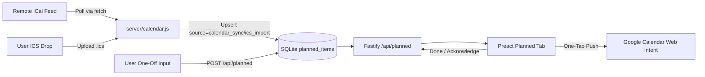

# Requirements

### Overview & Goals
Introduce **Planned Items & Calendar Sync** in Chorelenger to maximize personal productivity and scheduling reliability while minimizing friction and cognitive overhead. 

The system clearly differentiates between two distinct categories of future commitments:
1. **One-Off Planned Tasks** (internal additions): Actionable tasks with timeframes (e.g. family requests, errands) that can be pushed to Google Calendar on demand via 1-tap web intents and marked "Done" upon completion.
2. **External Calendar Events** (automated iCal feed polling & .ics import): Read-only event synchronizations from external calendars (Google Calendar, Apple, Outlook) with clear visual calendar branding and a dedicated "Acknowledge / Remembered" confirmation workflow to ensure upcoming events are never forgotten.

### Scope
#### In Scope
- **Planned Items & Settings Data Model**: Storage for one-off items, synchronized calendar events, and calendar feed configuration (`app_settings` / `planned_items`).
- **Read-Only Automated Calendar Polling**:
  - Configurable private iCal feed URL (`webcal://` or `https://...basic.ics`) fetched on demand and during planned view refreshes.
  - Zero-credential pure Node.js RFC 5545 parser that idempotently upserts events by `external_uid`.
  - Manual `.ics` drag-and-drop import fallback.
- **On-Demand Google Calendar Web Intent**: One-tap "Add to Google Calendar" link generation for internal one-off items (`calendar.google.com/calendar/render?action=TEMPLATE...`).
- **Visual Distinction & Dual Confirmation Lifecycles**:
  - Distinct UI badges and styling separating internal tasks (📝 One-Off Task) from external calendar entries (📅 Calendar Event).
  - Specialized action models: "Done" for task completion vs "Acknowledge" for calendar reminder awareness, both backed by 6-second undo toasts.
- **Dedicated Planned View**: Timeframe groupings (Today, Upcoming, Later, Completed / Acknowledged).

#### Out of Scope
- Direct two-way Google Calendar OAuth2 background write sync (web intent provides instantaneous 1-tap push without credential or token maintenance).
- Calendar `.ics` bulk export download (redundant given web intent pushing).
- Distorting recurring chore execution rates (planned items and calendar reminders are tracked independently to keep monthly habit metrics accurate).

### User Stories
- **As a user**, I want to capture a one-off request (e.g. "Take package to post office this Thursday") so that I can track it with a timeframe without cluttering my recurring chores.
- **As a user**, I want to push my one-off items to Google Calendar with a single tap so that my mobile calendar is updated instantly without complex setup.
- **As a user**, I want Chorelenger to automatically sync with my Google Calendar via secret iCal URL polling so that my upcoming schedule is always visible without manual file drops.
- **As a user**, I want a clear visual distinction between tasks I created in Chorelenger and events imported from my calendar so I immediately know what is an actionable task versus a scheduled commitment.
- **As a user**, I want separate confirmation workflows — "Done" for one-off tasks and "Acknowledge" for calendar events — with instant 6-second undo to minimize cognitive overhead and prevent accidental dismissals.

### Functional Requirements
1. **One-Off Task Management**:
   - Create, edit, and delete internal one-off items with `title` (required), `start_date` (YYYY-MM-DD), optional `start_time` (HH:MM), optional `end_time` (HH:MM), `notes`, and `location`.
   - Source marked as `manual`.
2. **Read-Only Calendar Sync & Feed Polling**:
   - Save secret iCal feed URL in app settings (`calendar_feed_url`).
   - Trigger sync via `POST /api/planned/sync` (and auto-refresh on tab load if feed configured).
   - Parse RFC 5545 `VEVENT` components and upsert records with `source = 'calendar_sync'` and `external_uid`.
   - Support manual `.ics` drag-and-drop file upload with `source = 'ics_import'`.
3. **Google Calendar Web Intent**:
   - For internal items, generate a pre-filled Google Calendar event URL (`https://calendar.google.com/calendar/render?action=TEMPLATE&text=...&dates=...&details=...&location=...`).
4. **Dual Confirmation Workflows**:
   - Internal items (`manual`): Button reads **Done**; sets `status = 'completed'` and records `completed_at`.
   - Calendar items (`calendar_sync`, `ics_import`): Button reads **Acknowledge**; sets `status = 'completed'` / acknowledged.
   - Both actions trigger a 6-second undo toast.
5. **Visual Differentiation & Filtering**:
   - Calendar items display a distinct badge (`📅 Calendar Event` vs `📝 One-Off Task`).
   - Items grouped by timeframe: Today, Upcoming, Later, Completed/Acknowledged.

### Non-Functional Requirements
- **Efficiency & Lightweight Execution**: Fast Pure JavaScript parser with zero native dependencies, ensuring fast execution on Termux (Android).
- **Security**: Authentication enforced on all sync and mutation endpoints; strict JSON payload validation.
- **Fault Tolerance**: Network failures during iCal polling gracefully report status without breaking local item views.

# Technical Design

### Current Implementation
Chorelenger currently operates with:
- `server/db.js`: Tables `chores`, `completions`, `extra_completions`, `sessions`.
- `server/schedule.js`: Pure schedule computation (interval, flexible window, calendar date).
- `server/app.js`: Fastify API with session cookie authentication and JSON CSRF defense.
- `web/src/main.jsx`: Preact SPA with tabs `today`, `chores`, `history`, `motivation`.

### Key Decisions
1. **Secret iCal Feed URL Polling & Pure JS RFC 5545 Engine**:
   - *Chosen Approach*: Use pure JavaScript parser (`server/calendar.js`) to parse remote iCal feeds and `.ics` uploads, storing events idempotently by `external_uid`.
   - *Rationale*: Maximizes utility by delivering automated synchronization without requiring Google Cloud Platform OAuth projects, refresh tokens, or native C++ dependencies on Termux.
2. **Web Intent Push for Outbound Calendar Creation**:
   - *Chosen Approach*: Generate Google Calendar Web Intent URLs (`calendar.google.com/calendar/render?action=TEMPLATE...`) client-side.
   - *Rationale*: Provides 1-tap calendar event generation on any device without external API rate limits or write permissions.
3. **Source Separation & Dual Confirmation Semantics**:
   - *Chosen Approach*: Store item origin in `source` (`manual` vs `calendar_sync` / `ics_import`). Render distinct badges and tailor confirmation copy ("Done" for internal tasks vs "Acknowledge" for calendar reminders).
   - *Rationale*: Eliminates cognitive confusion by clearly separating actionable task execution from awareness checkpoints for scheduled calendar events.
4. **Independent Tracking**:
   - *Chosen Approach*: Maintain planned items in a dedicated "Planned" tab, separated from recurring chore percentage metrics.
   - *Rationale*: Prevents one-off entries from skewing objective monthly habit execution rates.

### Proposed Changes
- **Calendar Engine (`server/calendar.js`)**:
  - `parseIcs(icsString)`: Pure parser extracting `UID`, `SUMMARY`, `DESCRIPTION`, `DTSTART`, `DTEND`, `LOCATION`, resolving all-day dates and UTC/local timestamps, unfolding multi-line text, and unescaping characters.
  - `fetchIcsFeed(url)`: Fetches private `.ics` feed with timeout and error handling.
- **Database Schema (`server/db.js`)**:
  - Add table `app_settings` (`key TEXT PRIMARY KEY`, `value TEXT NOT NULL`).
  - Add table `planned_items` with fields: `id`, `title`, `notes`, `start_date`, `start_time`, `end_time`, `is_all_day`, `location`, `source`, `external_uid`, `status`, `completed_at`, `created_at`.
- **Fastify API Routes (`server/app.js`)**:
  - `GET /api/planned` (query filters: `status`, `from_date`, `to_date`).
  - `POST /api/planned` (create internal one-off item).
  - `PUT /api/planned/:id` (update item).
  - `DELETE /api/planned/:id` (delete item).
  - `POST /api/planned/:id/confirm` (confirm item — Done or Acknowledged).
  - `DELETE /api/planned/:id/confirm` (undo confirmation).
  - `POST /api/planned/import-ics` (import `.ics` text payload).
  - `POST /api/planned/sync` (trigger iCal feed polling).
  - `GET /api/settings/calendar` & `PUT /api/settings/calendar` (manage iCal feed URL).
- **Web Frontend (`web/src/main.jsx` & `web/src/style.css`)**:
  - Add `Planned` tab with timeframe groupings (Today, Upcoming, Later, Completed/Acknowledged).
  - Badges distinguishing `📝 One-Off Task` and `📅 Calendar Event`.
  - Contextual action buttons: "Done" vs "Acknowledge", and "Add to Google Calendar" (for manual items).
  - Calendar Sync configuration bar and manual refresh trigger.
  - ICS drag-and-drop dropzone modal/section.

### Data Models / Contracts
```sql
CREATE TABLE IF NOT EXISTS app_settings (
  key TEXT PRIMARY KEY,
  value TEXT NOT NULL,
  updated_at TEXT NOT NULL DEFAULT (datetime('now'))
);

CREATE TABLE IF NOT EXISTS planned_items (
  id INTEGER PRIMARY KEY,
  title TEXT NOT NULL,
  notes TEXT NOT NULL DEFAULT '',
  start_date TEXT NOT NULL,
  start_time TEXT,
  end_time TEXT,
  is_all_day INTEGER NOT NULL DEFAULT 1,
  location TEXT NOT NULL DEFAULT '',
  source TEXT NOT NULL DEFAULT 'manual' CHECK (source IN ('manual', 'calendar_sync', 'ics_import')),
  external_uid TEXT,
  status TEXT NOT NULL DEFAULT 'pending' CHECK (status IN ('pending', 'completed')),
  completed_at TEXT,
  created_at TEXT NOT NULL DEFAULT (datetime('now'))
);
CREATE INDEX IF NOT EXISTS idx_planned_date ON planned_items(start_date, start_time);
CREATE INDEX IF NOT EXISTS idx_planned_status ON planned_items(status);
CREATE INDEX IF NOT EXISTS idx_planned_uid ON planned_items(external_uid);
```

### File Structure
- `server/calendar.js` *(new)*: Pure RFC 5545 parser and iCal feed fetcher.
- `server/calendar.test.js` *(new)*: Unit tests for iCal parsing, line unfolding, timezone handling, and feed ingestion.
- `server/db.js` *(modified)*: Add `app_settings` and `planned_items` tables and indices.
- `server/app.js` *(modified)*: Register `/api/planned` and `/api/settings/calendar` endpoints.
- `server/app.test.js` *(modified)*: API integration tests for CRUD, confirmation/undo, sync polling, and settings.
- `web/src/main.jsx` *(modified)*: Add Planned tab, item cards with source badges, dual confirmation triggers, Google Calendar intent builder, and sync settings modal.
- `web/src/style.css` *(modified)*: Styling for planned view, source badges, sync bar, and dropzone.
- `e2e/planned-items.spec.js` *(new)*: Playwright E2E tests for one-off creation, calendar feed sync, dual confirmation, undo toast, and Google Calendar link generation.
- `log.md` *(modified)*: Append increment log entry.
- `README.md` *(modified)*: Update documentation with planned items, calendar sync, and web intent usage.

### Architecture Diagram


### Risks
- **Feed Polling Latency & Network Failures**: Remote iCal feeds may occasionally time out or be unreachable.
  - *Mitigation*: Wrap feed requests in strict timeouts (10s) and display non-blocking sync status notifications while retaining existing cached events in SQLite.
- **Timestamp & All-Day Timezone Offsets**: Varying calendar exporters output either `VALUE=DATE:YYYYMMDD` or `YYYYMMDDTHHMMSSZ`.
  - *Mitigation*: Normalizer in `server/calendar.js` extracts date and time components cleanly in local ISO format.
- **Event Deletions in Remote Feeds**: Events removed from the remote calendar should be handled appropriately.
  - *Mitigation*: Sync routine marks removed future synced events or updates status without deleting historical manual items.

# Testing

### Validation Approach
Automated validation using:
1. **Unit Tests (`npm test`)**: Pure ICS parsing, folding, all-day vs timed events, and timezone normalization logic in `server/calendar.test.js`.
2. **API Integration Tests (`server/app.test.js`)**: Fastify endpoints for planned item CRUD, feed URL configuration, sync polling mock, status confirmation, undo, and authentication enforcement.
3. **E2E Black-Box Tests (`npm run test:e2e`)**: Playwright tests simulating user interactions: creating one-off items, configuring calendar sync, marking items Done/Acknowledged, verifying 6-second undo toast, and verifying Google Calendar intent URLs.

### Key Scenarios
- **Create & Push One-Off Item**: Create an internal one-off task, verify `📝 One-Off Task` badge, and check that the "Add to Google Calendar" button generates the correct URL.
- **Calendar Feed Sync**: Configure a secret iCal feed, trigger sync, and verify events populate with `📅 Calendar Event` badges.
- **Separate Confirmation Flows**:
  - Mark internal item as **Done**, check status change and undo toast.
  - Mark calendar event as **Acknowledge**, check acknowledged status and undo toast.
- **ICS File Import**: Import an `.ics` file via drag-and-drop and verify idempotent parsing.

### Edge Cases
- All-day events vs time-bound events across timezones.
- Feed polling when offline or when external server returns HTTP 500/404.
- Idempotency when synchronizing duplicate `UID` events.
- Reverting a confirmed item via undo toast after status change.

### Test Changes
- `server/calendar.test.js` *(new)*: Unit test suite for `parseIcs` and feed ingestion.
- `server/app.test.js` *(modified)*: Integration tests for `/api/planned` and `/api/settings/calendar` endpoints.
- `e2e/planned-items.spec.js` *(new)*: Playwright E2E test suite for Planned tab user journeys.

# Delivery Steps

### ✓ Step 1: Planned Items Data Model & Calendar Engine
Build the database schema and pure calendar parser for planned items and calendar events.

- Create `server/calendar.js` with pure RFC 5545 parser (`parseIcs`) handling `SUMMARY`, `DESCRIPTION`, `DTSTART`, `DTEND`, `LOCATION`, `UID`, multi-line unfolding, and date/time normalization.
- Add `server/calendar.test.js` unit tests covering all-day events, specific time slots, multi-line descriptions, and timezone strings.
- Update `server/db.js` schema with `app_settings` and `planned_items` tables and indices (`idx_planned_date`, `idx_planned_status`, `idx_planned_uid`).

### ✓ Step 2: Backend API Endpoints, Sync Polling & Integration Tests
Implement Fastify REST API endpoints for one-off items, calendar feed synchronization, and confirmation lifecycles.

- Add CRUD endpoints (`GET /api/planned`, `POST /api/planned`, `PUT /api/planned/:id`, `DELETE /api/planned/:id`) in `server/app.js`.
- Add confirmation and undo endpoints (`POST /api/planned/:id/confirm` and `DELETE /api/planned/:id/confirm`).
- Add calendar sync endpoints (`GET /api/settings/calendar`, `PUT /api/settings/calendar`, `POST /api/planned/sync`, and `POST /api/planned/import-ics`).
- Add integration tests in `server/app.test.js` verifying authentication, CRUD operations, sync polling logic, and dual confirmation lifecycles.

### ✓ Step 3: Frontend Planned View with Source Separation & Google Calendar Intents
Build the dedicated Planned UI tab in Preact with visual source badges, dual confirmation actions, and Google Calendar link generation.

- Add the "Planned" navigation tab in `web/src/main.jsx` organizing items into timeframe sections (Today, Upcoming, Later, Completed/Acknowledged).
- Render visual source indicators distinguishing `📝 One-Off Task` from `📅 Calendar Event`.
- Implement tailored confirmation buttons: "Done" for internal tasks vs "Acknowledge" for calendar reminders, with 6-second undo toast support.
- Implement client-side Google Calendar Web Intent button for 1-tap event creation on internal one-off items.
- Add calendar sync configuration modal and `.ics` file dropzone.
- Add responsive styling in `web/src/style.css` for source badges, sync controls, item cards, and action triggers.

### ✓ Step 4: End-to-End Verification & Documentation
Add Playwright black-box E2E test suite and update project documentation.

- Create `e2e/planned-items.spec.js` verifying one-off item creation, Google Calendar web intent links, calendar feed sync, and dual confirmation with undo.
- Update `README.md` and `.planning/PROJECT.md` with planned items and calendar sync instructions.
- Append a detailed increment log entry to `log.md` conforming to `AGENTS.md`.